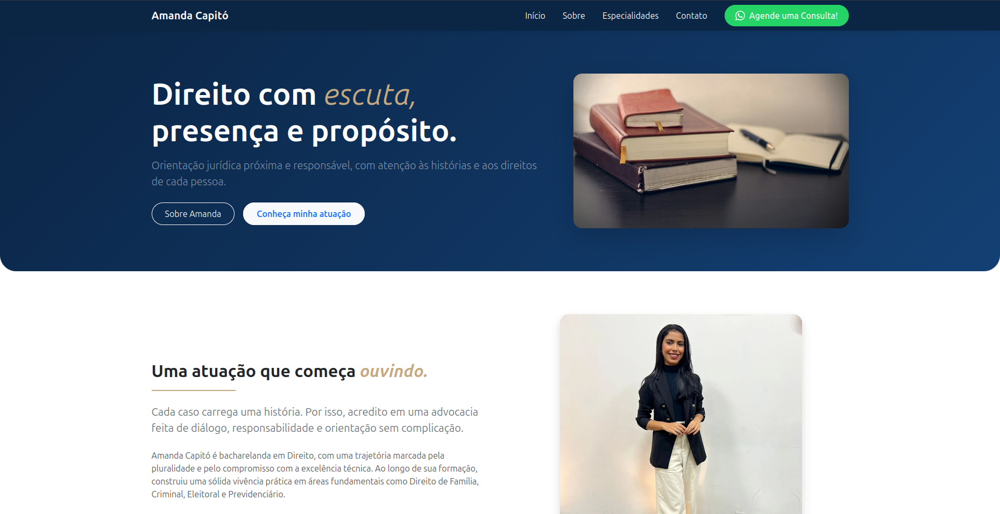

# ⚖️ Projeto: Landing Page - Amanda Capitó | Orientação Jurídica

Este é um projeto desenvolvido para aprimorar habilidades na criação de landing pages institucionais modernas e responsivas no segmento de serviços jurídicos. Trata-se de uma página voltada para consultoria e orientação jurídica, combinando um visual profissional, animações sutis e total adaptabilidade a diferentes dispositivos.

🔗 **[Veja o projeto na prática](https://ricardo-viniicius.github.io/Landing-page-Amanda/)**

---

## 📸 Prévia do Projeto

  

---

## 📝 Sobre o Projeto

O objetivo principal desta reestruturação foi modernizar a interface, tornando-a mais fluida, acessível e totalmente responsiva. Entre as melhorias implementadas, destacam-se:
* **Atualização Visual:** Nova paleta de cores refinada para transmitir maior seriedade, sofisticação e confiança.
* **Otimização de Conteúdo:** Remoção de seções desnecessárias (como a localização física) para focar na conversão e na clareza dos serviços oferecidos.
* **Responsividade Avançada:** Implementação do **Bootstrap** para garantir uma experiência de navegação impecável em celulares, tablets e computadores.
* **Animação de Entrada:** Adição de um efeito suave e sutil utilizando `@keyframes` no CSS para suavizar o carregamento e a atualização da página.

---

## 🛠 Tecnologias Utilizadas

- **HTML5:** Estrutura semântica da página, organizando o menu de navegação, seções de conteúdo e blocos de serviços.
- **CSS3:** Estilização personalizada, paleta de cores institucional, animações via `@keyframes` e efeitos visuais.
- **Bootstrap:** Framework utilitário para garantir o design responsivo (Mobile-First) e o alinhamento de componentes.
- **Git & GitHub Pages:** Versionamento de código e hospedagem contínua da aplicação.

---

## 🚀 O que eu pratiquei e aprendi:

- **Responsividade com Bootstrap:** Utilização do sistema de grids e classes utilitárias para adaptação automática de layouts em múltiplos tamanhos de tela.
- **Animações CSS (`@keyframes`):** Criação de transições e efeitos de fade/entrada suaves para melhorar a experiência visual do usuário ao carregar a página.
- **Efeito Flip Card 3D (CSS Puro):** Desenvolvimento de cartões interativos com propriedades como `perspective`, `transform: rotateY` e `backface-visibility` acionadas via `:hover`.
- **Hierarquia Visual e Tipografia:** Ajustes finos de espaçamento, contraste e cores para assegurar uma leitura agradável e corporativa.
- **Refatoração de Código:** Limpeza e reorganização do layout, removendo seções obsoletas e otimizando a estrutura geral.

---

## 📬 Contato

Desenvolvido por **Ricardo Vinícius**. Sinta-se à vontade para entrar em contato ou enviar sugestões através do meu perfil no GitHub!